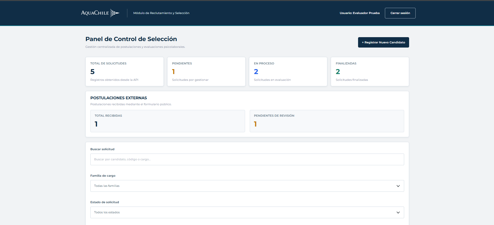
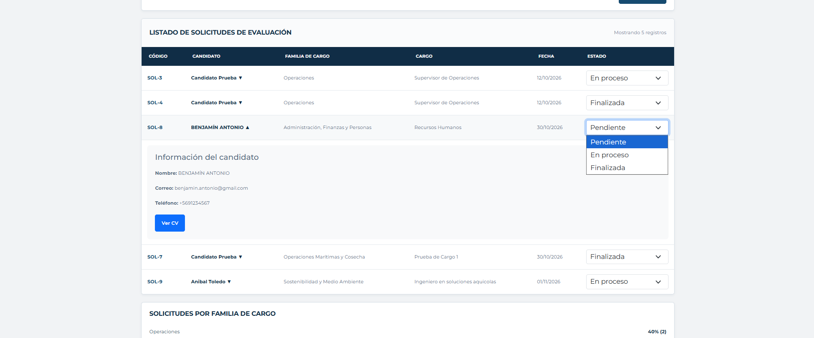
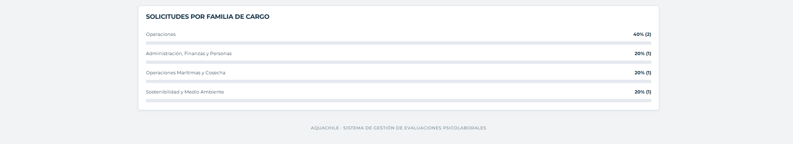

# AquaChile — Sistema de Gestión de Reclutamiento y Selección

## 1. Descripción del proyecto

**AquaChile** es una aplicación web desarrollada como un MVP (Producto Mínimo Viable) para apoyar la gestión de los procesos de reclutamiento y selección de personal de AquaChile.

El sistema busca centralizar la información de los candidatos, organizar las solicitudes de evaluación psicolaboral y facilitar el seguimiento de cada proceso mediante una plataforma digital.

La solución está orientada principalmente al área de Reclutamiento y Selección, permitiendo que sus colaboradores registren candidatos, consulten solicitudes y gestionen los estados de evaluación de acuerdo con los permisos asociados a su rol.

La aplicación incorpora una interfaz de gestión empresarial, un panel de control y herramientas que permiten mejorar la organización, trazabilidad y acceso a la información.

## 2. Integrantes del proyecto

El proyecto fue desarrollado por:

- **Aníbal Toledo:** Desarrollo Frontend e interfaz de usuario.
- **Benjamín Yovanovich:** Desarrollo Frontend y lógica de la aplicación.
- **Benjamín Sepúlveda:** Diseño e implementación de la base de datos.

## 3. Objetivos del sistema

### Objetivo general

Desarrollar una aplicación web que permita gestionar de manera centralizada los candidatos y las solicitudes de evaluación psicolaboral, facilitando el trabajo del área de Reclutamiento y Selección de AquaChile.

### Objetivos específicos

- Centralizar los antecedentes personales y laborales de los candidatos.
- Registrar solicitudes de evaluación psicolaboral.
- Facilitar el seguimiento de los estados de cada solicitud.
- Diferenciar las funcionalidades disponibles según el rol del usuario.
- Mantener un registro de los cambios de estado para mejorar la trazabilidad.
- Incorporar un formulario público para recibir postulaciones laborales.

## 4. Funcionamiento general y flujo del sistema

El sistema contempla dos vías principales de ingreso de candidatos:

**Registro interno:** un usuario del área de Reclutamiento y Selección ingresa los antecedentes del candidato, selecciona la familia de cargo y el cargo específico, adjunta su currículum y puede incorporar observaciones internas.

**Postulación pública:** una persona interesada en trabajar en AquaChile puede completar un formulario de postulación y enviar sus antecedentes y currículum para su posterior revisión.

### Flujo general

1. El usuario interno ingresa al sistema mediante sus credenciales.
2. El backend valida las credenciales y los permisos correspondientes al rol.
3. El usuario accede al panel de control de selección.
4. Desde el dashboard puede consultar solicitudes, revisar indicadores, buscar candidatos y aplicar filtros.
5. El usuario puede acceder a los antecedentes del candidato y consultar la información disponible.
6. El evaluador puede actualizar el estado de las solicitudes según el avance del proceso.
7. El backend procesa los cambios y registra la información correspondiente en la base de datos.
8. Las postulaciones externas recibidas mediante el formulario público quedan disponibles para su posterior revisión.

### Roles del sistema

| Rol | Función principal |
|---|---|
| ANALISTA | Registrar candidatos y consultar solicitudes. |
| EVALUADOR | Consultar solicitudes y actualizar sus estados. |
| JEFATURA | Rol orientado a la consulta y seguimiento de información. |
| ADMINISTRADOR_ACADEMICO | Rol definido dentro de la estructura de usuarios del sistema. |

Los permisos se gestionan desde el backend mediante Spring Security, evitando depender exclusivamente de las restricciones visuales del frontend.

## 5. Funcionalidades implementadas

### 5.1. Panel de control (Dashboard)

El dashboard permite consultar y organizar la información de las solicitudes de evaluación psicolaboral mediante una interfaz centralizada.

Entre sus funcionalidades se encuentran:

- Visualización del total de solicitudes.
- Indicadores de solicitudes pendientes, en proceso y finalizadas.
- Resumen de postulaciones externas recibidas mediante el formulario público.
- Identificación de postulaciones pendientes de revisión.
- Listado de solicitudes de evaluación.
- Búsqueda por candidato, código o cargo.
- Filtrado por familia de cargo.
- Filtrado por estado de solicitud.
- Consulta de antecedentes adicionales del candidato.
- Acceso al currículum vitae cuando está disponible.
- Actualización de estados según los permisos del usuario.
- Visualización de solicitudes agrupadas por familia de cargo.

Los indicadores permiten obtener una visión general del estado de los procesos de reclutamiento y selección.

### 5.2. Registro interno de candidatos

El formulario interno permite ingresar los antecedentes necesarios para registrar un candidato.

Incluye:

- Nombre completo.
- Correo electrónico.
- Teléfono de contacto.
- Familia de cargo.
- Cargo específico al que postula.
- Currículum Vitae.
- Observaciones internas.

El formulario incorpora validaciones de campos obligatorios, formato de correo electrónico y archivos adjuntos.

Se permiten archivos PDF y DOCX con un tamaño máximo de 10 MB.

Los datos se envían al backend para su procesamiento y almacenamiento.

### 5.3. Postulación pública

El sistema dispone de un formulario de postulación pública que permite recibir antecedentes de personas interesadas en trabajar en AquaChile.

Este formulario comparte los campos principales del registro de candidatos, pero está adaptado para su utilización por personas externas a la organización.

### 5.4. Autenticación y control de acceso

Se implementó un sistema de autenticación mediante credenciales de usuario y contraseña.

La aplicación reconoce los siguientes roles:

- ANALISTA.
- EVALUADOR.
- JEFATURA.
- ADMINISTRADOR_ACADEMICO.

El control de acceso se implementa en el backend mediante Spring Security.

Las restricciones también se reflejan en la interfaz. Por ejemplo, el selector de estado se muestra al evaluador, mientras que el analista visualiza el estado sin disponer de controles para modificarlo.

### 5.5. Gestión de estados y trazabilidad

Las solicitudes de evaluación cuentan con tres estados:

- **Pendiente:** la solicitud se encuentra pendiente de gestión.
- **En proceso:** la solicitud se encuentra en etapa de evaluación.
- **Finalizada:** el proceso de evaluación ha sido finalizado.

El evaluador puede modificar el estado de una solicitud directamente desde el dashboard.

Cada actualización se procesa en el backend y se registra en una tabla de auditoría que almacena:

- Solicitud modificada.
- Responsable que realizó el cambio.
- Estado anterior.
- Estado nuevo.
- Fecha y hora del cambio.

La actualización de la solicitud y su registro de auditoría se realizan dentro de una transacción para mantener la consistencia de la información.

## 6. Tecnologías utilizadas

### Frontend

- **React:** construcción de la interfaz mediante componentes reutilizables.
- **JavaScript (ES6+):** lógica de la aplicación, validaciones y manejo de estados.
- **Vite:** entorno de desarrollo y compilación del frontend.
- **CSS y Bootstrap:** estructura visual, estilos y diseño de los componentes.
- **Vitest:** ejecución de pruebas automatizadas.
- **React Testing Library:** pruebas de componentes e interfaces.
- **jest-dom:** utilidades para realizar comprobaciones sobre elementos del DOM.

### Backend

- **Java 21:** lenguaje de programación utilizado para desarrollar la lógica del servidor.
- **Spring Boot:** framework utilizado para implementar la aplicación backend y sus servicios.
- **Spring Security:** autenticación y autorización según los roles de usuario.
- **Maven:** gestión de dependencias y compilación del proyecto.

### Base de datos

- **PostgreSQL:** sistema gestor de base de datos relacional.
- **Supabase:** plataforma utilizada para alojar y administrar la base de datos.

## 7. Arquitectura general

El proyecto utiliza una arquitectura cliente-servidor compuesta por tres capas principales:

1. **Frontend:** desarrollado en React, permite a los usuarios interactuar con los formularios y el dashboard.
2. **Backend:** desarrollado en Spring Boot, procesa las solicitudes, valida los permisos y ejecuta las operaciones de negocio.
3. **Base de datos:** PostgreSQL alojado en Supabase, almacena la información de los candidatos, responsables, solicitudes y evaluaciones.

La comunicación entre frontend y backend se realiza mediante solicitudes HTTP a los endpoints de la API.

El backend es responsable de validar las operaciones y mantener la integridad de los datos almacenados.

## 8. Base de datos

La base de datos se diseñó considerando las necesidades del proceso de reclutamiento y selección.

Entre sus principales tablas se encuentran:

| Tabla | Descripción |
|---|---|
| `candidato` | Almacena los antecedentes de los candidatos. |
| `responsable` | Almacena la información de los usuarios internos. |
| `rol` | Define los roles disponibles en el sistema. |
| `solicitud_evaluacion` | Registra las solicitudes de evaluación psicolaboral. |
| `evaluacion` | Almacena información asociada a las evaluaciones. |
| `log_estado_solicitud` | Registra el historial de cambios de estado de las solicitudes. |

Se implementaron claves primarias, claves foráneas, restricciones de integridad y validaciones para mantener la consistencia de los datos.

El diseño también contempla relaciones entre responsables y roles, además de la trazabilidad de los cambios realizados sobre las solicitudes.

## 9. Pruebas realizadas

Durante el desarrollo se realizaron pruebas de funcionamiento e integración para verificar las principales operaciones del sistema.

Entre las pruebas realizadas se encuentran:

- Inicio de sesión con diferentes roles.
- Consulta de información del usuario autenticado.
- Acceso del analista al listado de solicitudes.
- Restricción de modificación de estados para el analista.
- Actualización de estados por parte del evaluador.
- Persistencia de los cambios en PostgreSQL.
- Registro de los cambios en la tabla de auditoría.
- Registro de candidatos mediante el formulario interno.
- Verificación de la comunicación entre frontend, backend y base de datos.
- Pruebas automatizadas de renderizado de componentes mediante Vitest y React Testing Library.

### 9.1. Pruebas automatizadas del frontend

Se incorporaron pruebas automatizadas para comprobar el funcionamiento general de las principales pantallas y layouts del frontend.

Los archivos de pruebas se encuentran organizados en `src/test/`:

| Archivo | Pruebas |
|---|---:|
| `Dashboard.test.jsx` | 2 |
| `Login.test.jsx` | 2 |
| `FormularioCandidato.test.jsx` | 4 |
| `ModuloLayout.test.jsx` | 1 |
| `DetalleLayout.test.jsx` | 1 |
| **Total** | **10** |

Las pruebas verifican principalmente:

- Renderizado de las pantallas.
- Presencia de títulos y elementos principales.
- Existencia de campos de formulario.
- Presencia de botones.
- Renderizado del contenido dentro de los layouts.

La configuración de las pruebas se encuentra en `src/test/setup.js`, donde se importa `@testing-library/jest-dom/vitest` para habilitar las funciones de comprobación de elementos del DOM.

### 9.2. Ejecución de las pruebas

Desde la carpeta del frontend (`aquachile-app`), ejecutar:

**Ejecutar todas las pruebas:**

```powershell
npx vitest run
```

**Ejecutar las pruebas en modo interactivo:**

```powershell
npx vitest
```

**Ejecutar las pruebas con informe de cobertura:**

```powershell
npx vitest run --coverage
```

La cobertura permite conocer qué porcentaje de instrucciones, ramas, funciones y líneas del código fue ejecutado durante las pruebas.

Las pruebas automatizadas del frontend se enfocan en la comprobación general de los componentes y no reemplazan las pruebas de integración del backend y la base de datos.

## 10. Instalación y ejecución local

### Requisitos previos

Para ejecutar el proyecto se necesita:

- Node.js y npm.
- Java JDK 21.
- Git.
- Acceso a la base de datos PostgreSQL en Supabase.

### Clonar el repositorio

```bash
git clone https://github.com/anibaldogamer/Proyecto_AquaChile
```

Ingresar a la carpeta del proyecto:

```bash
cd Proyecto_AquaChile
```

### Ejecutar el backend

Desde la carpeta del backend:

```powershell
cd aquachile-backend
.\mvnw.cmd spring-boot:run
```

El backend utiliza el puerto `8080` por defecto.

Antes de ejecutarlo, se deben configurar las credenciales de conexión a PostgreSQL y las variables de entorno requeridas por la aplicación.

**Importante:** no se comparten contraseñas ni credenciales privadas en este repositorio.

### Ejecutar el frontend

Desde otra terminal, ingresar a la carpeta del frontend:

```powershell
cd aquachile-app
```

Instalar las dependencias:

```powershell
npm install
```

Iniciar el servidor de desarrollo:

```powershell
npm run dev
```

Vite iniciará el servidor de desarrollo, normalmente disponible en:

```text
http://localhost:5173
```

El frontend utiliza la configuración de proxy de Vite para comunicarse con el backend durante el desarrollo local.

### Ejecutar las pruebas del frontend

Desde la carpeta `aquachile-app`, ejecutar:

```powershell
npx vitest run
```

Para generar el informe de cobertura:

```powershell
npx vitest run --coverage
```

## 11. Estado actual del proyecto

El proyecto cuenta con una primera versión funcional que integra frontend, backend y base de datos.

Se encuentran implementados y probados:

- Registro interno de candidatos.
- Consulta de solicitudes.
- Dashboard de gestión de reclutamiento y selección.
- Indicadores de solicitudes por estado.
- Consulta y filtrado de solicitudes.
- Resumen de postulaciones externas.
- Autenticación de usuarios.
- Control de acceso según roles.
- Actualización de estados por parte del evaluador.
- Restricción de modificación de estados para el analista.
- Registro de auditoría de los cambios realizados.
- Formulario de postulación pública.
- Pruebas automatizadas generales del frontend.

Se organizaron las pruebas automatizadas en archivos independientes dentro de `src/test/`, obteniendo un resultado de **10 pruebas aprobadas en 5 archivos de prueba**.

El sistema continúa en desarrollo, por lo que algunas funcionalidades y procesos de administración se encuentran sujetos a futuras mejoras e integración.

## 12. Capturas del sistema

A continuación, se presentan algunas vistas de la aplicación desarrollada, que permiten conocer su interfaz y las principales funcionalidades implementadas.

### 12.1. Inicio de sesión

Pantalla de acceso al sistema para los usuarios internos.


### 12.2. Panel de control

Vista principal del sistema, donde se centraliza la información de los candidatos y las solicitudes de evaluación.







Vista del listado de solicitudes, información de candidatos y gestión de estados.


Vista de solicitudes agrupadas por familia de cargo y sus indicadores de distribución.


### 12.3. Registro interno de candidatos

Formulario utilizado por el personal de Reclutamiento y Selección para ingresar nuevos candidatos al sistema.


### 12.4. Postulación pública

Interfaz destinada a las personas interesadas en postular a oportunidades laborales en AquaChile.


## 13. Conclusión

AquaChile busca transformar un proceso de gestión de candidatos y evaluaciones psicolaborales en un flujo digital centralizado, organizado y trazable.

La solución desarrollada permite conectar distintas etapas del proceso, desde el ingreso de antecedentes hasta el seguimiento de las solicitudes, incorporando control de acceso según los roles de los usuarios y almacenamiento persistente de la información.

Este MVP constituye una base funcional para continuar ampliando y mejorando la gestión de reclutamiento y selección de AquaChile.